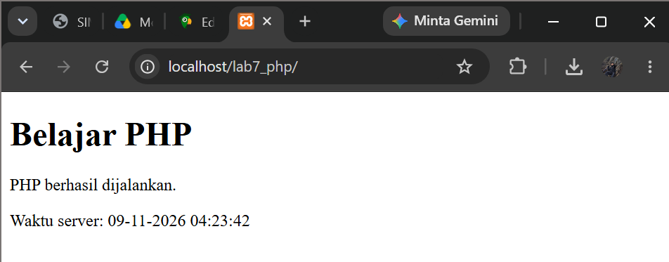
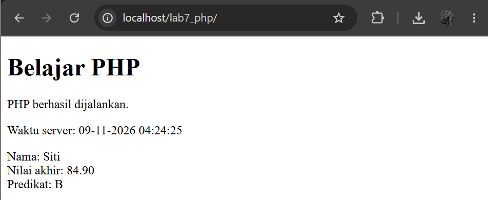
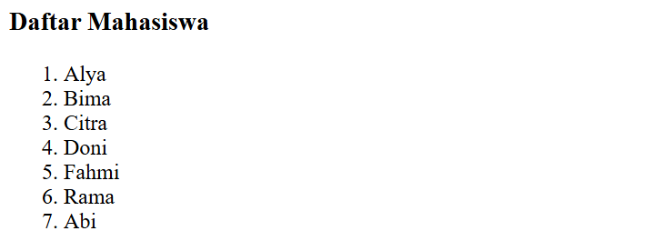
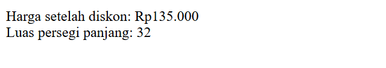
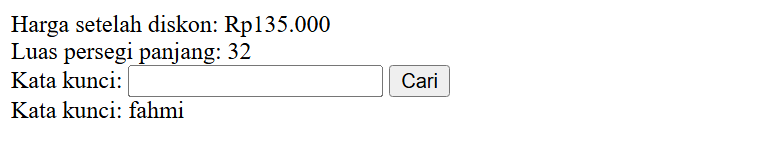
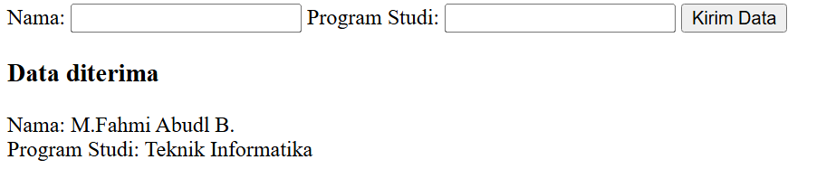
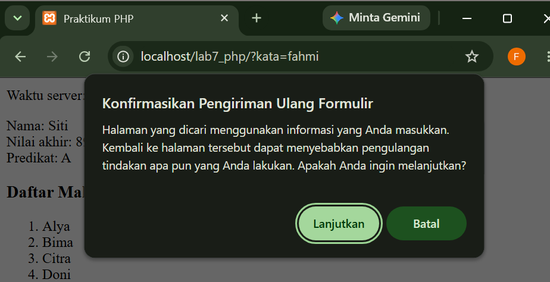
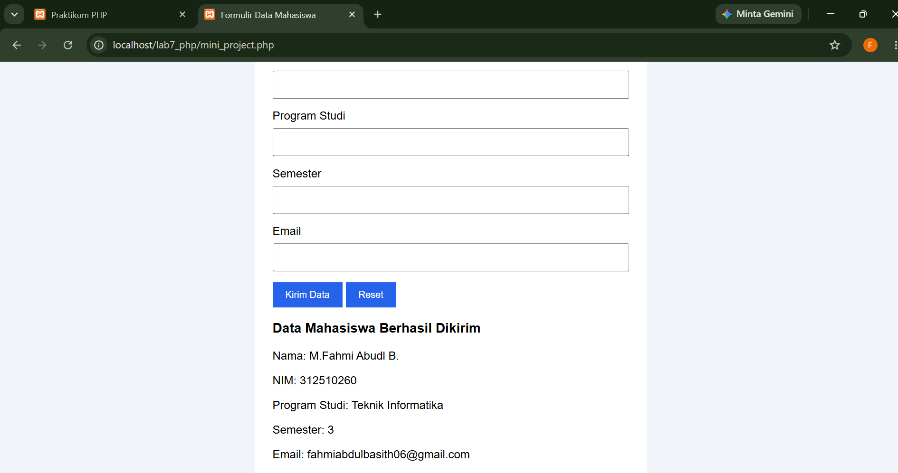
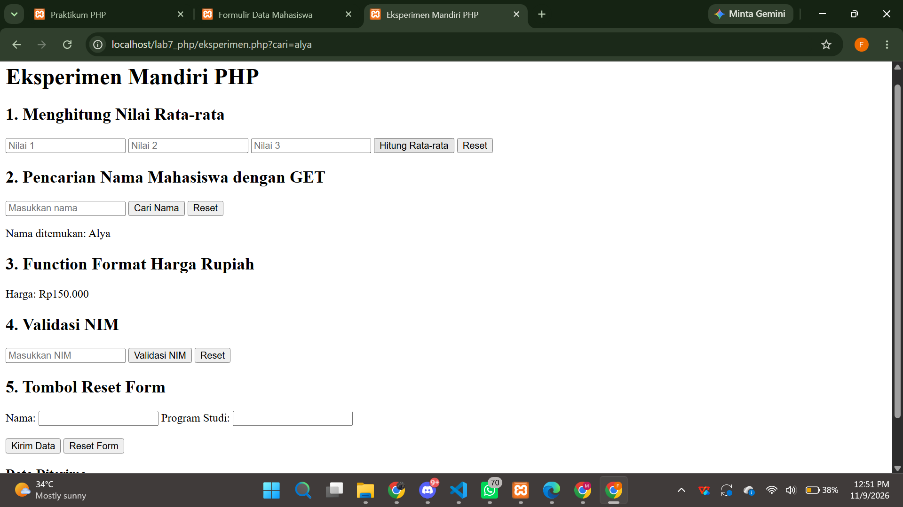

# LAPORAN PRAKTIKUM 7
## PEMROGRAMAN SERVER-SIDE DENGAN PHP

**Mata Kuliah:** Pemrograman Web  
**Nomor Modul:** 7  
**Topik:** Pemrograman Server-Side dengan PHP  
**Nama:** M. Fahmi Abdul Basith  
**NIM:** 312510260  
**Program Studi:** Teknik Informatika  

---

## 1. Tujuan Praktikum

Praktikum ini bertujuan untuk:

1. Memahami perbedaan pemrosesan client-side dan server-side.
2. Mengenali sintaks PHP dan menjalankan file PHP melalui server lokal.
3. Menggunakan variabel, tipe data, operator, percabangan, perulangan, dan function.
4. Menerima dan memproses data dari form HTML menggunakan metode GET dan POST.
5. Melakukan validasi dan sanitasi input sebelum data ditampilkan atau diproses.
6. Membangun aplikasi sederhana yang dapat menerima, memproses, dan menampilkan data pengguna.

## 2. Perangkat yang Digunakan

Perangkat yang digunakan dalam praktikum ini adalah:

- Laptop/PC.
- Visual Studio Code sebagai editor kode.
- XAMPP sebagai server lokal.
- PHP sebagai bahasa pemrograman server-side.
- Apache sebagai web server.
- Google Chrome sebagai web browser.

## 3. Struktur Folder

Struktur folder proyek Praktikum 7 yang digunakan adalah:

```text
lab7_php/
│
├── index.php
├── eksperimen.php
├── mini_project.php
└── README.md
```

**Keterangan File:**

1. `index.php`: Berisi pengerjaan Latihan 1 sampai Latihan 7, meliputi menjalankan PHP, variabel, operator, percabangan, array, perulangan, function, form GET, form POST, dan pengolahan data transaksi.
2. `eksperimen.php`: Berisi lima eksperimen mandiri sesuai arahan modul.
3. `mini_project.php`: Berisi aplikasi formulir data mahasiswa dengan metode POST dan validasi input.
4. `README.md`: Berisi dokumentasi praktikum, tujuan, perangkat, langkah kerja, pengujian, dan kesimpulan.

## 4. Persiapan Lingkungan Praktikum

### Langkah 1 — Menyiapkan XAMPP

1. Instal aplikasi XAMPP pada komputer.
2. Buka XAMPP Control Panel.
3. Jalankan layanan Apache dengan menekan tombol Start.
4. Pastikan Apache menunjukkan status Running.

### Langkah 2 — Membuat Folder Proyek

Buka direktori instalasi XAMPP, kemudian masuk ke folder `htdocs`.

Buat folder proyek dengan nama:

```text
C:\xampp\htdocs\lab7_php
```

### Langkah 3 — Membuka Proyek di Visual Studio Code

1. Buka Visual Studio Code.
2. Pilih menu File.
3. Klik Open Folder.
4. Pilih folder `lab7_php`.
5. Pastikan file `index.php`, `eksperimen.php`, dan `mini_project.php` berada di dalam folder tersebut.

### Langkah 4 — Menjalankan Program

Pastikan Apache sudah berjalan, kemudian buka Google Chrome.

Masukkan alamat berikut:

```text
http://localhost/lab7_php/
```

Untuk menjalankan file lainnya:

```text
http://localhost/lab7_php/eksperimen.php
```

```text
http://localhost/lab7_php/mini_project.php
```

**Catatan:** File PHP harus dijalankan melalui web server menggunakan localhost, bukan dengan membuka file secara langsung melalui File Explorer.

## 5. Langkah Kerja Praktikum

### Latihan 1 — Menjalankan PHP

**File:** `index.php`

Pada latihan pertama, dilakukan pengujian untuk memastikan PHP dapat dijalankan melalui web server.

Kode yang digunakan:

```php
<?php
    echo "<p>PHP berhasil dijalankan.</p>";
    echo "<p>Waktu server: " . date("d-m-Y H:i:s") . "</p>";
?>
```

Langkah pengerjaan:

1. Buka file `index.php` di Visual Studio Code.
2. Masukkan kode PHP untuk menampilkan pesan dan waktu server.
3. Simpan file dengan menekan Ctrl + S.
4. Buka browser dan akses:

```text
http://localhost/lab7_php/
```

**Hasil:** Browser menampilkan tulisan Belajar PHP, pesan bahwa PHP berhasil dijalankan, dan waktu server.

**Screenshot:** 


### Latihan 2 — Variabel, Operator, dan Percabangan

**File:** `index.php`

Pada latihan kedua, dilakukan perhitungan nilai akhir mahasiswa berdasarkan nilai tugas, UTS, dan UAS.

Kode yang digunakan:

```php
<?php
    $nama = "Siti";
    $tugas = 90;
    $uts = 80;
    $uas = 95;

    $nilaiAkhir = ($tugas * 0.30) +
                  ($uts * 0.30) +
                  ($uas * 0.40);

    if ($nilaiAkhir >= 85) {
        $predikat = "A";
    } elseif ($nilaiAkhir >= 75) {
        $predikat = "B";
    } elseif ($nilaiAkhir >= 60) {
        $predikat = "C";
    } else {
        $predikat = "D";
    }

    echo "Nama: " . htmlspecialchars($nama) . "<br>";
    echo "Nilai akhir: " . number_format($nilaiAkhir, 2) . "<br>";
    echo "Predikat: " . $predikat;
?>
```

Langkah pengerjaan:

1. Buka file `index.php`.
2. Periksa bagian variabel nama, tugas, UTS, dan UAS.
3. Program menghitung nilai akhir dengan bobot tugas 30%, UTS 30%, dan UAS 40%.
4. Percabangan menentukan predikat berdasarkan nilai akhir.
5. Ubah nilai tugas, UTS, dan UAS untuk menguji hasil perhitungan.
6. Simpan dan refresh browser.

**Hasil:** Program menampilkan nama mahasiswa, nilai akhir, dan predikat berdasarkan hasil perhitungan.

**Screenshot:** 


### Latihan 3 — Perulangan dan Array

**File:** `index.php`

Pada latihan ketiga, digunakan array untuk menyimpan beberapa nama mahasiswa dan perulangan `foreach` untuk menampilkan seluruh data.

Kode yang digunakan:

```php
<?php
    $mahasiswa = [
        "Alya",
        "Bima",
        "Citra",
        "Doni",
        "Fahmi",
        "Rama",
        "Abi"
    ];

    echo "<h3>Daftar Mahasiswa</h3><ol>";

    foreach ($mahasiswa as $nama) {
        echo "<li>" . htmlspecialchars($nama) . "</li>";
    }

    echo "</ol>";
?>
```

Langkah pengerjaan:

1. Buka file `index.php`.
2. Buat array yang berisi daftar nama mahasiswa.
3. Gunakan `foreach` untuk membaca setiap nama.
4. Tampilkan seluruh nama dalam bentuk daftar.
5. Simpan dan jalankan kembali program melalui browser.

**Hasil:** Browser menampilkan daftar tujuh nama mahasiswa menggunakan perulangan `foreach`.

**Screenshot:** 


### Latihan 4 — Membuat Function

**File:** `index.php`

Pada latihan keempat, dibuat function untuk menghitung harga setelah diskon dan luas persegi panjang.

Kode yang digunakan:

```php
<?php
    function hitungDiskon($harga, $persen) {
        $potongan = $harga * ($persen / 100);
        return $harga - $potongan;
    }

    $hargaAkhir = hitungDiskon(150000, 10);

    echo "Harga setelah diskon: Rp" .
         number_format($hargaAkhir, 0, ",", ".");

    function hitungLuasPersegiPanjang($panjang, $lebar) {
        return $panjang * $lebar;
    }

    $luas = hitungLuasPersegiPanjang(8, 4);

    echo "<br>Luas persegi panjang: " . $luas;
?>
```

Langkah pengerjaan:

1. Buka file `index.php`.
2. Buat function `hitungDiskon()` untuk menghitung harga setelah diskon.
3. Buat function `hitungLuasPersegiPanjang()` untuk menghitung luas.
4. Masukkan nilai harga, persentase diskon, panjang, dan lebar.
5. Simpan dan jalankan program melalui browser.

**Hasil:** Program menampilkan harga setelah diskon sebesar 10% dan luas persegi panjang.

**Screenshot:** 


### Latihan 5 — Memproses Form dengan GET

**File:** `index.php`

Pada latihan kelima, digunakan metode GET untuk menerima kata kunci dari form HTML.

Kode yang digunakan:

```php
<form method="GET" action="">
    <label for="kata">Kata kunci:</label>
    <input id="kata" name="kata" type="text">
    <button type="submit">Cari</button>
</form>

<?php
    if (isset($_GET["kata"])) {
        $kata = trim($_GET["kata"]);

        echo "Kata kunci: " .
             htmlspecialchars($kata, ENT_QUOTES, "UTF-8");
    }
?>
```

Langkah pengerjaan:

1. Buka file `index.php`.
2. Buat form pencarian menggunakan metode GET.
3. Masukkan kata kunci pada kolom yang tersedia.
4. Tekan tombol Cari.
5. Perhatikan hasil yang ditampilkan dan perubahan parameter pada URL browser.

**Hasil:** Program menampilkan kata kunci yang dimasukkan melalui form GET.

**Catatan:** Metode GET tidak digunakan untuk mengirim kata sandi atau data sensitif.

**Screenshot:** 


### Latihan 6 — Memproses Form dengan POST

**File:** `index.php`

Pada latihan keenam, digunakan metode POST untuk menerima nama dan program studi mahasiswa.

Kode yang digunakan:

```php
<form method="POST" action="">
    <label for="nama">Nama:</label>
    <input id="nama" name="nama" type="text" required>

    <label for="prodi">Program Studi:</label>
    <input id="prodi" name="prodi" type="text" required>

    <button type="submit" name="kirim">Kirim Data</button>
</form>

<?php
    if ($_SERVER["REQUEST_METHOD"] === "POST") {
        $nama = trim($_POST["nama"] ?? "");
        $prodi = trim($_POST["prodi"] ?? "");

        if ($nama === "" || $prodi === "") {
            echo "<p>Semua kolom wajib diisi.</p>";
        } else {
            echo "<h3>Data diterima</h3>";
            echo "Nama: " .
                 htmlspecialchars($nama, ENT_QUOTES, "UTF-8") . "<br>";

            echo "Program Studi: " .
                 htmlspecialchars($prodi, ENT_QUOTES, "UTF-8");
        }
    }
?>
```

Langkah pengerjaan:

1. Buka file `index.php`.
2. Buat form dengan kolom nama dan program studi.
3. Gunakan metode POST untuk mengirim data.
4. Tambahkan pemeriksaan agar kolom tidak kosong.
5. Gunakan `htmlspecialchars()` untuk menampilkan kembali input pengguna dengan aman.
6. Uji menggunakan data lengkap, input kosong, tanda kutip, dan tag HTML.

**Hasil:** Program menampilkan data mahasiswa apabila input telah diterima dan memenuhi pemeriksaan.

**Screenshot:** 


### Latihan 7 — Pengolahan Data Sederhana

**File:** `index.php`

Pada latihan ketujuh, dibuat form transaksi sederhana yang menerima nama barang, harga, dan jumlah barang. PHP kemudian menghitung subtotal transaksi.

Kode yang digunakan:

```php
<?php
    $barang = trim($_POST["barang"] ?? "");
    $hargaInput = $_POST["harga"] ?? "";
    $jumlahInput = $_POST["jumlah"] ?? "";

    $hasil = null;

    if ($_SERVER["REQUEST_METHOD"] === "POST") {
        if (
            $barang === "" ||
            !is_numeric($hargaInput) ||
            !ctype_digit((string)$jumlahInput) ||
            (float)$hargaInput < 0 ||
            (int)$jumlahInput < 1
        ) {
            $error = "Periksa kembali nama barang, harga, dan jumlah.";
        } else {
            $harga = (float)$hargaInput;
            $jumlah = (int)$jumlahInput;
            $subtotal = $harga * $jumlah;
        }
    }
?>

<form method="POST">
    <label>Nama barang
        <input name="barang" required>
    </label>

    <label>Harga
        <input name="harga" type="number"
               min="0" step="0.01" required>
    </label>

    <label>Jumlah
        <input name="jumlah" type="number"
               min="1" step="1" required>
    </label>

    <button type="submit">Hitung</button>
</form>

<?php
    if (isset($error)) {
        echo "<p>" . htmlspecialchars($error) . "</p>";
    } elseif (isset($subtotal)) {
        echo "<p>Barang: " .
             htmlspecialchars($barang) . "</p>";

        echo "<p>Subtotal: Rp" .
             number_format($subtotal, 0, ",", ".") . "</p>";
    }
?>
```

Langkah pengerjaan:

1. Buka file `index.php`.
2. Buat form nama barang, harga, dan jumlah.
3. Gunakan metode POST untuk mengirim data transaksi.
4. Periksa nama barang, harga, dan jumlah menggunakan validasi PHP.
5. Hitung subtotal dengan mengalikan harga dan jumlah.
6. Tampilkan ringkasan transaksi apabila input valid.
7. Uji harga desimal, jumlah nol, jumlah negatif, dan data yang tidak sesuai.

**Hasil:** Program menampilkan nama barang dan subtotal apabila data transaksi valid. Jika input tidak sesuai, program menampilkan pesan kesalahan.

**Screenshot:** 
.

## 6. Mini Project — Aplikasi Formulir Data Mahasiswa

**File:** `mini_project.php`

Mini Project merupakan aplikasi sederhana untuk menerima dan menampilkan data mahasiswa menggunakan metode POST.

Formulir terdiri dari:

- Nama mahasiswa.
- NIM.
- Program studi.
- Semester.
- Email.

### Langkah Pengerjaan

1. Buka file `mini_project.php` pada Visual Studio Code.
2. Buat variabel untuk menyimpan data yang diterima.
3. Gunakan metode POST untuk menerima data dari form.
4. Lakukan validasi pada setiap kolom.
5. Periksa format email menggunakan `filter_var()`.
6. Periksa semester agar berupa bilangan bulat dari 1 sampai 14.
7. Gunakan `htmlspecialchars()` untuk menampilkan data.
8. Jalankan program melalui browser.

### Kode Pemrosesan Data

Kode berikut merupakan bagian pemrosesan yang terdapat dalam file `mini_project.php`:

```php
<?php
    $data = null;
    $error = [];

    if ($_SERVER["REQUEST_METHOD"] === "POST") {
        $nama = trim($_POST["nama"] ?? "");
        $nim = trim($_POST["nim"] ?? "");
        $prodi = trim($_POST["prodi"] ?? "");
        $semesterInput = $_POST["semester"] ?? "";
        $email = trim($_POST["email"] ?? "");

        if ($nama === "") {
            $error[] = "Nama wajib diisi.";
        }

        if ($nim === "") {
            $error[] = "NIM wajib diisi.";
        }

        if ($prodi === "") {
            $error[] = "Program studi wajib diisi.";
        }

        if (!filter_var($email, FILTER_VALIDATE_EMAIL)) {
            $error[] = "Format email tidak valid.";
        }

        if (
            !ctype_digit((string)$semesterInput) ||
            (int)$semesterInput < 1 ||
            (int)$semesterInput > 14
        ) {
            $error[] = "Semester harus berupa angka 1-14.";
        }

        if (!$error) {
            $data = compact("nama", "nim", "prodi", "email");
            $data["semester"] = (int)$semesterInput;
        }
    }
?>
```

### Menjalankan Mini Project

Buka browser dan akses:

```text
http://localhost/lab7_php/mini_project.php
```

Isi seluruh kolom formulir, kemudian tekan tombol Kirim Data.

**Hasil yang diharapkan:**

- Formulir dapat menerima data mahasiswa.
- Data dikirim menggunakan metode POST.
- Kolom wajib diperiksa.
- Email diperiksa menggunakan validasi format.
- Semester harus berupa bilangan bulat antara 1 sampai 14.
- Jika terdapat kesalahan, sistem menampilkan pesan kesalahan.
- Jika seluruh data valid, sistem menampilkan ringkasan data mahasiswa.

**Screenshot:** Masukkan screenshot formulir, hasil pengiriman data valid, dan hasil validasi data tidak valid.


## 7. Eksperimen Mandiri

**File:** `eksperimen.php`

Eksperimen mandiri dibuat untuk menerapkan kembali konsep PHP yang telah dipelajari pada latihan sebelumnya.

File `eksperimen.php` berisi lima percobaan sebagai berikut.

### Eksperimen 1 — Menghitung Nilai Rata-rata

Menghitung nilai rata-rata dari tiga komponen nilai menggunakan metode POST.

```php
$rataRata = ($nilai1 + $nilai2 + $nilai3) / 3;
```

**Hasil:** Program menampilkan nilai rata-rata berdasarkan tiga nilai yang dimasukkan.

### Eksperimen 2 — Pencarian Nama Mahasiswa dengan GET

Mencari nama mahasiswa dari array menggunakan metode GET dan perulangan `foreach`.

```php
$mahasiswa = ["Alya", "Bima", "Citra", "Doni"];

foreach ($mahasiswa as $nama) {
    if (stripos($nama, $cari) !== false) {
        echo "Nama ditemukan: " . htmlspecialchars($nama);
    }
}
```

**Hasil:** Program menampilkan nama apabila ditemukan dan pesan bahwa nama tidak ditemukan apabila pencarian tidak cocok.

### Eksperimen 3 — Function Format Harga Rupiah

Membuat function untuk mengubah angka menjadi format mata uang Rupiah.

```php
function formatRupiah($harga) {
    return "Rp" . number_format($harga, 0, ",", ".");
}

$harga = 150000;

echo formatRupiah($harga);
```

**Hasil:** Program menampilkan harga dalam format Rupiah.

### Eksperimen 4 — Validasi NIM

Melakukan validasi NIM menggunakan fungsi `ctype_digit()` dan `strlen()`.

```php
if (ctype_digit($nim) && strlen($nim) === 10) {
    echo "NIM valid: " . htmlspecialchars($nim);
} else {
    echo "NIM tidak valid. NIM harus terdiri dari 10 digit angka.";
}
```

**Hasil:** Program menerima NIM yang terdiri dari 10 digit angka dan menolak input yang tidak sesuai.

### Eksperimen 5 — Tombol Reset Form

Membuat form dengan tombol Kirim Data dan Reset Form.

```html
<button type="submit" name="kirim">Kirim Data</button>
<button type="reset">Reset Form</button>
```

**Hasil:** Tombol Reset mengosongkan kembali input pada form di browser. Tombol tersebut berbeda dengan pengiriman form karena tidak mengirim data untuk diproses oleh server.

### Menjalankan Eksperimen

Akses alamat berikut melalui browser:

```text
http://localhost/lab7_php/eksperimen.php
```

**Screenshot:** 


## 8. Pengujian Program

Pengujian dilakukan untuk memastikan setiap program dapat menerima input yang sesuai dan menolak input yang tidak sesuai.

### A. Pengujian Input Valid

| No. | Pengujian | Input | Hasil |
|---|---|---|---|
| 1 | Perhitungan nilai | Tugas 90, UTS 80, UAS 95 | Nilai akhir berhasil dihitung |
| 2 | Form transaksi | Buku, harga 10000, jumlah 2 | Subtotal Rp20.000 |
| 3 | Mini Project | Data mahasiswa lengkap dan email valid | Data berhasil ditampilkan |
| 4 | Validasi NIM | 3125102600 | NIM valid |
| 5 | Pencarian nama | Alya | Nama ditemukan |

### B. Pengujian Input Tidak Valid

| No. | Pengujian | Input | Hasil |
|---|---|---|---|
| 1 | Form POST | Nama atau program studi kosong | Menampilkan pesan kesalahan |
| 2 | Form transaksi | Jumlah barang 0 | Input ditolak |
| 3 | Mini Project | Email tidak valid | Menampilkan pesan format email tidak valid |
| 4 | Mini Project | Semester 15 | Menampilkan pesan semester tidak valid |
| 5 | Validasi NIM | 12345 | NIM tidak valid |


## 9. Kesimpulan

Berdasarkan praktikum yang telah dilakukan, PHP dapat digunakan untuk menjalankan pemrosesan data pada sisi server. Praktikum ini memberikan pemahaman mengenai penggunaan variabel, operator, percabangan, perulangan, array, dan function.

Selain itu, praktikum mempelajari pemrosesan data menggunakan metode GET dan POST, validasi input, serta penggunaan `htmlspecialchars()` untuk menampilkan data pengguna dengan lebih aman.

Melalui Mini Project dan eksperimen mandiri, konsep pemrograman server-side diterapkan dalam bentuk aplikasi sederhana yang dapat menerima, memvalidasi, mengolah, dan menampilkan data mahasiswa.


## H. Pertanyaan Evaluasi

**1. Apa perbedaan antara `echo` dan `print` dalam PHP?**

`echo` digunakan untuk menampilkan satu atau lebih teks ke halaman web, sedangkan `print` digunakan untuk menampilkan satu teks dan mengembalikan nilai 1.

**2. Mengapa kode PHP harus dijalankan melalui server seperti XAMPP?**

Karena PHP merupakan bahasa pemrograman yang diproses di sisi server (*server-side*). XAMPP menyediakan Apache sebagai web server untuk menjalankan kode PHP.

**3. Apa perbedaan antara GET dan POST?**

GET mengirimkan data melalui URL sehingga data dapat terlihat pada alamat browser. POST mengirimkan data melalui bagian body request sehingga tidak ditampilkan pada URL.

**4. Mengapa validasi input harus dilakukan di sisi server?**

Agar data yang dikirim pengguna tetap diperiksa oleh server, sehingga data kosong atau tidak sesuai ketentuan dapat ditolak meskipun validasi di browser dilewati.

**5. Apa fungsi `htmlspecialchars()` dalam PHP?**

Untuk mengubah karakter khusus HTML menjadi bentuk yang aman saat ditampilkan pada halaman web sehingga membantu mencegah serangan XSS.

**6. Apa perbedaan variabel, array, dan fungsi dalam PHP?**

- Variabel digunakan untuk menyimpan satu nilai.
- Array digunakan untuk menyimpan beberapa nilai dalam satu variabel.
- Fungsi digunakan untuk mengelompokkan kode agar dapat dipanggil kembali.

**7. Mengapa proses pengolahan data sebaiknya dipisahkan dari tampilan HTML?**

Agar kode lebih terstruktur, mudah dibaca, mudah diperbaiki, dan lebih mudah dikembangkan.
